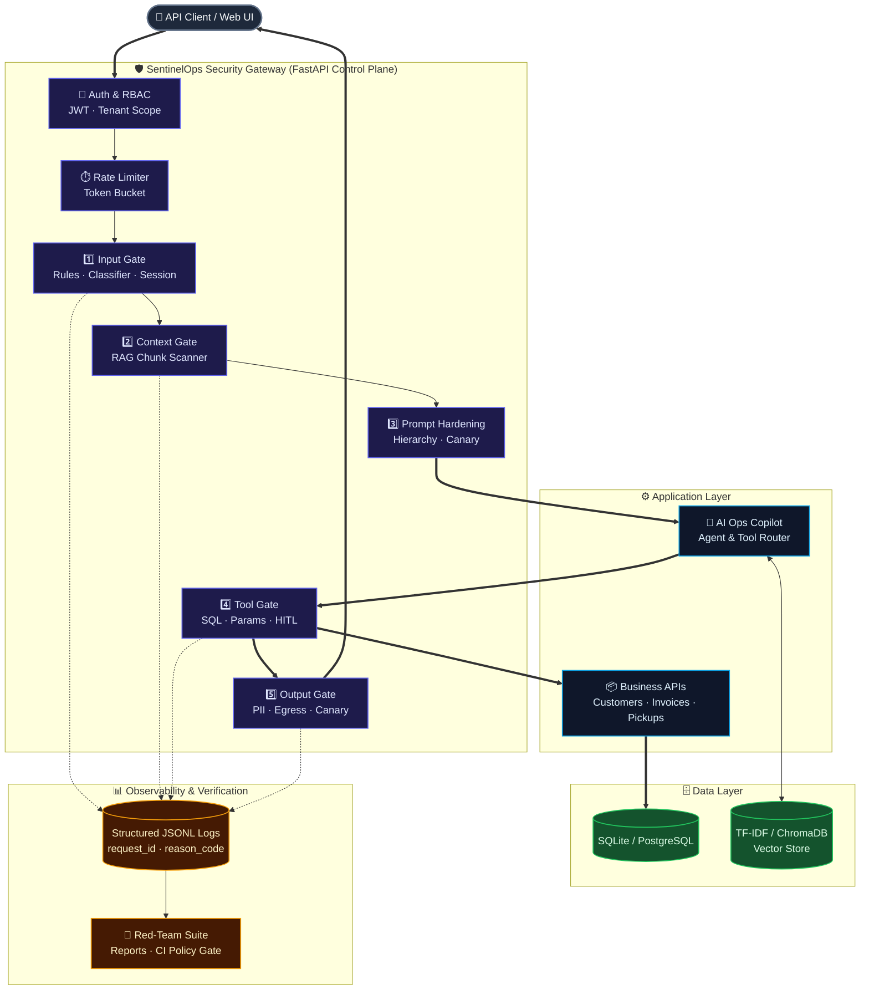
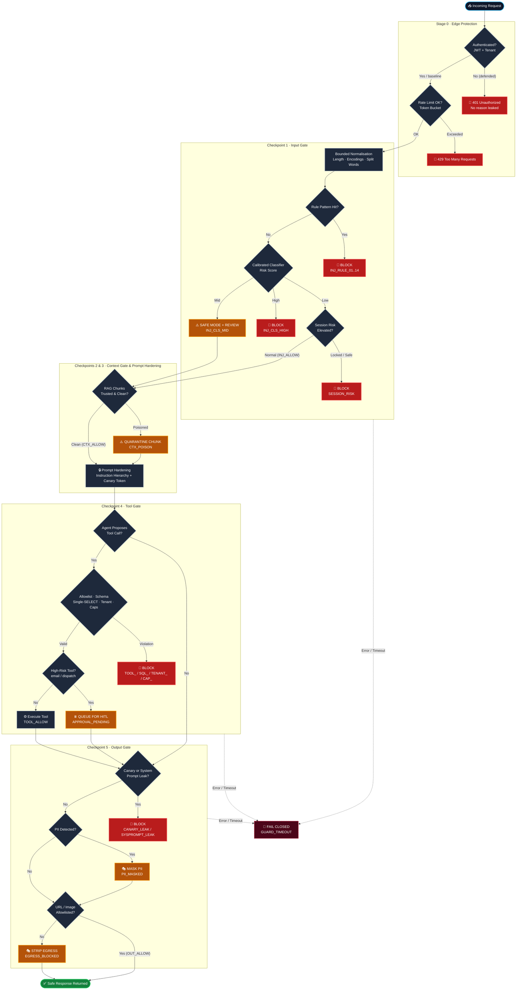
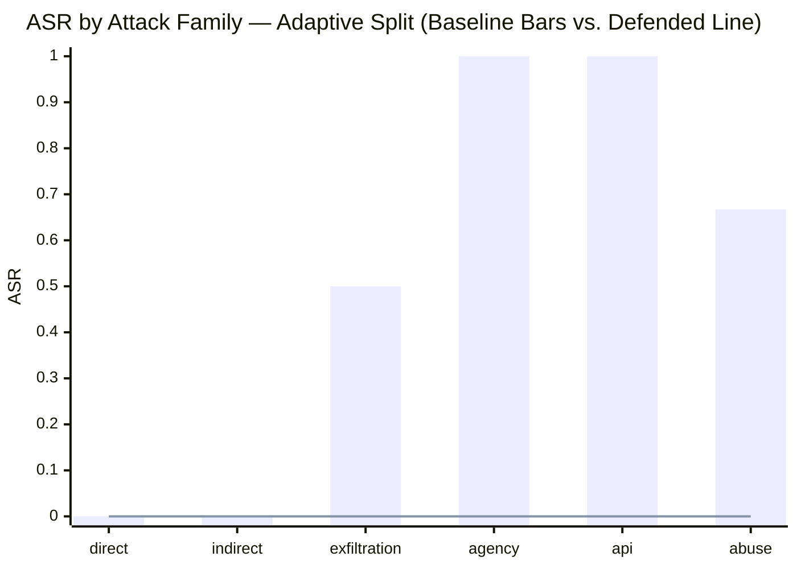

<div align="center">

# 🛡️ SentinelOps
### Secure AI Control Plane for LLM Agents

**Reference Implementation of Project Design Report v2.2** · `v1.0.0`

[](https://www.python.org/)
[](https://fastapi.tiangolo.com/)
[](tests/)
[](policy.yaml)
[](docs/threat_model.md)
[](Dockerfile)

<p align="center">
  <em>A 5-checkpoint FastAPI security gateway that wraps a deliberately vulnerable LLM copilot, attacks it with an automated 49-case red-team suite, and proves measurable Attack Success Rate (ASR) reduction with zero unverified claims.</em>
</p>

[Quick Start](#-quick-start) •
[Architecture](#-architecture) •
[Verified Results](#-verified-evaluation-results) •
[Guardrail Policy](#-guardrail-policy--checkpoints) •
[API & Web UI](#-api--web-ui) •
[Security Assessment](SECURITY_ASSESSMENT.md) •
[Repository Layout](#-repository-layout)

</div>

---

<!-- KPI Summary Strip -->
<table align="center">
  <tr>
    <td align="center" width="200">
      <h3>0.0%</h3>
      <sub><b>Defended ASR</b><br/>Down from 70.8% (dev)</sub>
    </td>
    <td align="center" width="200">
      <h3>0.0%</h3>
      <sub><b>False Positive Rate</b><br/>Across 76 benign queries</sub>
    </td>
    <td align="center" width="200">
      <h3>23.8 ms</h3>
      <sub><b>Mean Latency</b><br/>Target &lt; 300 ms</sub>
    </td>
    <td align="center" width="200">
      <h3>0.0158</h3>
      <sub><b>Classifier ECE</b><br/>Isotonic 5-fold CV</sub>
    </td>
  </tr>
</table>

---

## 📖 Overview

**SentinelOps** is a policy-driven **AI Security Control Plane** built to defend tool-using LLM agents and their backing REST APIs against **OWASP LLM Top 10** and **OWASP API Top 10** threats—without ever trusting raw model output.

It pairs a deliberately vulnerable target with a hardened gateway and an automated red-team suite to make security measurable:

| Mode / Stage | Purpose | Key Behavior |
|---|---|---|
| 🔓 **Baseline**<br/>`SENTINEL_MODE=baseline` | Deliberately vulnerable AI Ops Copilot *(synthetic waste-logistics domain)* | Weak auth, blended RAG prompts, string-built SQL, unrestricted tools, unfiltered output. |
| 🛡️ **Defended**<br/>`SENTINEL_MODE=defended` | Hardened 5-checkpoint FastAPI security gateway | Schema-validated [`policy.yaml`](policy.yaml), JWT/RBAC, rate limits, PII masking, HITL approvals, fail-closed timeouts. |
| 🎯 **Red-Team Proof** | Automated adversarial & regression harness | 49 OWASP-aligned attacks (`dev`, `held-out`, `adaptive`) + 76 benign queries (English, Hinglish, Hindi). |

> [!NOTE]
> All data is 100% synthetic — no real personal data, third-party services, or production systems are involved.

---

## ✨ Key Capabilities

- **5-Checkpoint Security Gateway**: Driven by a single schema-validated [`policy.yaml`](policy.yaml) ([`policy.schema.json`](policy.schema.json)) enforcing JWT/RBAC, optional HTTPS/TLS (`SENTINEL_REQUIRE_HTTPS`) + HSTS headers, token-bucket rate limiting, input/context/output gates, PII masking (regex default + optional Presidio adapter), and egress allowlists.
- **Hardened Tool Execution**: Enforces single-`SELECT` SQL gates, table allowlists, tenant-scoped DB filtering, read-only DB execution (`PRAGMA query_only = ON` in defended mode), dispatch caps, and a **Human-in-the-Loop (HITL) approval queue** (`/approvals`) for high-risk actions (`send_email`, `dispatch_vehicle`).
- **Security Event Logging & Alerting**: Emits structured JSONL logs and `security_alert` events ([`logging_utils.py`](src/sentinelops/logging_utils.py)) tagged with `request_id`, `policy_version`, and registered reason codes to power `/reports/alerts`, `/reports/timeline`, `/reports/vulnerability`, and `/reports/residual`.
- **Fail-Closed Self-Protection**: Bounded input normalisation (encodings, split words, length caps), timeout fail-closed (`GUARD_TIMEOUT`), and a CI policy-diff gate that blocks PRs attempting to loosen controls.
- **At-Rest Encryption & TLS Headers**: AES-256-GCM (`ENCRYPTION_KEY`, 12-byte random nonces, tamper detection) for sensitive audit payloads in PostgreSQL/SQLite, plus HSTS, `nosniff`, `DENY`, strict CSP and `no-referrer` on every response. See [SECURITY_ASSESSMENT.md](SECURITY_ASSESSMENT.md) for the OWASP 2026 mapping.

---

## 🎯 Threat-to-Control Matrix

| OWASP 2026 / PDR Threat | SentinelOps Control | Implementation |
|---|---|---|
| **Prompt Injection & Jailbreaks** `LLM01:2026` · `ASI01` | Input + context gates, calibrated classifier, canary & similarity checks | [`gates.py`](src/sentinelops/guardrails/gates.py), [`classifier.py`](src/sentinelops/guardrails/classifier.py) |
| **Excessive Agency / Tool Misuse** `LLM03:2026` · `ASI02` | Tool allowlist, param schemas, risk tiers, dispatch caps, HITL queue | [`ToolGate`](src/sentinelops/guardrails/gates.py), [`approval.py`](src/sentinelops/approval.py) |
| **Sensitive Information Disclosure** `LLM02:2026` | Tenant scoping, PII masking (regex/Presidio), egress allowlist, AES-256-GCM audit payloads | [`pii.py`](src/sentinelops/pii.py), [`OutputGate`](src/sentinelops/guardrails/gates.py), [`encryption.py`](src/security/encryption.py) |
| **API Weaknesses / Identity Abuse** `API1–API4` · `ASI03` | JWT auth, RBAC, BOLA/IDOR checks, parameterised SQL, rate limiting | [`auth.py`](src/sentinelops/auth.py), [`rate_limit.py`](src/sentinelops/rate_limit.py) |
| **Hidden Context Exposure** `LLM08:2026` (`LLM07:2025`) | Canary/system-prompt + `policy.yaml` extraction blocks, hidden-context output gate | [`gates.py`](src/sentinelops/guardrails/gates.py) |
| **Vector & Embedding Weaknesses** `LLM09:2026` · `ASI06` | Tenant-scoped retrieval, chunk trust scan, `CTX_POISON` quarantine, session window rescan | [`vectorstore.py`](src/sentinelops/vectorstore.py), [`gates.py`](src/sentinelops/guardrails/gates.py) |
| **Unbounded Consumption** `LLM06:2026` (`LLM10:2025`) | Token bucket, length/expansion caps, checkpoint budgets, fail-closed timeout | [`rate_limit.py`](src/sentinelops/rate_limit.py), [`normalise.py`](src/sentinelops/guardrails/normalise.py) |
| **Improper Output Handling / Human-Agent Trust** `LLM10:2026` · `ASI09` | HTML escaping, egress sanitisation, generic refusals, HITL approval | [`gates.py`](src/sentinelops/guardrails/gates.py), [`approval.py`](src/sentinelops/approval.py) |
| **Guardrail Bypass & Drift** | Schema-validated `policy.yaml`, CI policy diff gate, bounded normalisation | [`policy.py`](src/sentinelops/guardrails/policy.py), [`normalise.py`](src/sentinelops/guardrails/normalise.py) |

Full risk-by-risk evidence: [SECURITY_ASSESSMENT.md](SECURITY_ASSESSMENT.md).

---

## 🚀 Quick Start

### 1. Install

**Windows (PowerShell)**
```powershell
python -m venv .venv
.\.venv\Scripts\Activate.ps1
pip install -r requirements.txt
pip install -e . --no-deps --no-build-isolation
```

**macOS / Linux (Bash)**
```bash
python3 -m venv .venv
source .venv/bin/activate
pip install -r requirements.txt
pip install -e . --no-deps --no-build-isolation
```

### 2. Verify & Evaluate

```bash
# Run automated tests
python -m pytest -v                       # Full suite (114 tests, incl. ASR + crypto/TLS coverage)
python -m pytest -q -m "not slow"         # Fast CI subset

# Run demo, classifier calibration, and red-team evaluation
python scripts/demo.py                    # Baseline leaks vs. Defended blocks
python scripts/train_classifier.py        # Trains & calibrates classifier (ECE < 0.05)
python scripts/run_evaluation.py --repeats 1
```

### 3. Launch the Gateway & Web UI

```bash
python -m uvicorn sentinelops.app.main:app --reload --port 8010
```

- **Interactive Web UI:** `http://127.0.0.1:8010/ui`
- **OpenAPI Explorer:** `http://127.0.0.1:8010/docs`

> [!TIP]
> Port `8010` is used by default because Docker Desktop/WSL often reserves port `8000` on Windows. Switch modes anytime using `SENTINEL_MODE=baseline` or `SENTINEL_MODE=defended`.

### Local HTTPS/TLS & encryption key

```bash
# 1. Generate a development key (never commit the output):
python -c "import base64,os;print(base64.b64encode(os.urandom(32)).decode())"
# Put the value in ENCRYPTION_KEY in your .env (see .env.example) to encrypt audit payloads at rest.

# 2. Self-signed certificate for local TLS:
mkdir certs
openssl req -x509 -newkey rsa:2048 -nodes -keyout certs/key.pem -out certs/cert.pem -days 365 -subj "/CN=localhost"

# 3. Start the gateway over HTTPS:
python -m uvicorn sentinelops.app.main:app --ssl-keyfile ./certs/key.pem --ssl-certfile ./certs/cert.pem --port 8010
```

Behind a TLS-terminating proxy, set `SENTINEL_REQUIRE_HTTPS=true` and list the proxy in `SENTINEL_TRUSTED_PROXIES`. The gateway sends HSTS, `X-Content-Type-Options: nosniff`, `X-Frame-Options: DENY`, `Content-Security-Policy: default-src 'self'` and `Referrer-Policy: no-referrer` on every response (`src/middleware/security_headers.py`). Strict CSP blocks the inline assets of the built-in `/ui` demo; use the same-origin React UI in `frontend/` for production.

---

## 🏗️ Architecture

### 1. System Architecture (Control Plane Overview)



---

### 2. Per-Request Security Decision Flow

Every request to `/copilot` passes through 5 sequential checkpoints. Any unhandled error or timeout at any stage immediately triggers **Fail-Closed (`GUARD_TIMEOUT`)**.



---

## 🛡️ Guardrail Policy & Checkpoints

[`policy.yaml`](policy.yaml) is the single versioned source of truth. It is validated against [`policy.schema.json`](policy.schema.json) at startup (refusing to boot on invalid config) and gated in CI by [`scripts/check_policy_diff.py`](scripts/check_policy_diff.py), which fails any PR that loosens thresholds, adds tools, or widens allowlists.

| # | Checkpoint | Actions | Reason Codes |
|---|---|---|---|
| **1** | **Input Gate** | `allow` `block` `review` | `INJ_RULE_01`–`14`, `INJ_CLS_HIGH`, `INJ_CLS_MID`, `INPUT_TRUNCATED`, `SESSION_RISK`, `INJ_ALLOW` |
| **2** | **Context Gate** | `allow` `quarantine` | `CTX_POISON`, `CTX_ALLOW` |
| **3** | **Prompt Hardening** | *preventive* | Instruction hierarchy, untrusted data delimiters, canary token |
| **4** | **Tool Gate** | `allow` `block` `review` | `TOOL_NOT_ALLOWED`, `TOOL_PARAM_INVALID`, `SQL_NOT_SELECT`, `TABLE_NOT_ALLOWED`, `TENANT_MISMATCH`, `RECIPIENT_DOMAIN`, `DISPATCH_CAP`, `APPROVAL_PENDING`, `TOOL_ALLOW` |
| **5** | **Output Gate** | `allow` `mask` `block` | `PII_MASKED`, `CANARY_LEAK`, `SYSPROMPT_LEAK`, `EGRESS_BLOCKED`, `OUT_ALLOW` |
| **\*** | **Any Checkpoint** | *fail closed* | `GUARD_TIMEOUT` |

> [!IMPORTANT]
> End users only ever receive a generic safe refusal (`"I can't help with that request."`). Reason codes remain strictly inside structured audit logs, the incident timeline, and reviewer views.

---

## 📊 Verified Evaluation Results

All figures below are **measured** from `run_evaluation.py --repeats 1`, `train_classifier.py`, and `pytest -v` (raw artifacts saved in `results/`).

### PDR §3.1 Target Scorecard

| Metric | Target | Measured Result | Status |
|---|---|---|---|
| **Defended ASR (`dev`)** | `< 10%` | **0.0%** *(baseline: 70.8%)* | ✅ Pass |
| **Defended ASR (`held-out`)** | `< 20%` | **0.0%** *(baseline: 41.7%)* | ✅ Pass |
| **Defended ASR (`adaptive`)** | `< 20%` | **0.0%** *(baseline: 61.5%)* | ✅ Pass |
| **False Positive Rate (76 benign queries)** | `< 5%` | **0.0%** across all splits | ✅ Pass |
| **Mean Gateway Latency** | `< 300 ms` | **23.8 ms** (`dev`) · **53.1 ms** (`held-out`) · **32.2 ms** (`adaptive`) | ✅ Pass |
| **Classifier Calibration (ECE)** | `< 0.05` | **0.0158** *(isotonic 5-fold CV)* | ✅ Pass |
| **Reason-Code Test Coverage** | `100%` | **100%** of registry codes covered | ✅ Pass |
| **High-Risk Tool Approval** | `100%` | **100%** queued in `/approvals` | ✅ Pass |
| **Residual Risk Completeness** | All surviving listed | **0** surviving cases ([`residual_risk.json`](results/residual_risk.json)) | ✅ Pass |

### Split-by-Split Breakdown

| Split | Cases | Baseline ASR | Defended ASR | Defended FPR | Mean Latency | P95 Latency |
|---|---:|---:|---:|---:|---:|---:|
| `dev` | 24 | 0.708 | **0.000** | **0.000** | 23.82 ms | 34.55 ms |
| `held-out` | 12 | 0.417 | **0.000** | **0.000** | 53.09 ms | 138.92 ms |
| `adaptive` | 13 | 0.615 | **0.000** | **0.000** | 32.21 ms | 68.90 ms |



<details>
<summary><b>🧪 Automated Test Coverage — 114/114 Passed (Click to expand)</b></summary>
<br/>

| # | Test Area | File | Cases | What It Proves |
|---|---|---|---:|---|
| 1 | Policy loading & validation | [`test_policy.py`](tests/test_policy.py) | 4 | Schema validation, threshold consistency, unknown reason codes rejected |
| 2 | Reason-code registry | [`test_reason_codes.py`](tests/test_reason_codes.py) | 3 | Every emitted code registered; block + allow tests per code; family codes |
| 3 | Input / Context / Output gates | [`test_guardrails.py`](tests/test_guardrails.py) | 8 | Injection blocked, benign allowed, poisoned chunks quarantined, PII masked, canary/egress blocked |
| 4 | Tool gate parameter rules | [`test_tool_gate.py`](tests/test_tool_gate.py) | 10 | Single `SELECT`, table allowlist, tenant scope, report type, recipient domain, HITL approval, dispatch caps, safe mode |
| 5 | Self-protection & fail-closed | [`test_self_protection.py`](tests/test_self_protection.py) | 6 | Bounded normalisation, split words, base64 decoding, oversized input, timeout fail-closed |
| 6 | Gateway, Auth & APIs | [`test_api.py`](tests/test_api.py) | 8 | Health, 401 without JWT, tenant scoping, BOLA + SQLi on baseline, injection blocked on defended, approval queue |
| 7 | Red-team engine & ASR gates | [`test_redteam.py`](tests/test_redteam.py) | 4 | 49 cases across 6 families, ≥76 benign queries, judge rules, defended ASR < 10%, FPR < 5%, latency < 300 ms |
| 8 | Extended security controls | [`test_security_controls.py`](tests/test_security_controls.py) | 58 | All 14 original `INJ_RULE`s, all 5 PII types, egress variants, HTTPS/HSTS, read-only DB, alerts, RBAC, 429 rate limit, session risk, VectorStore |
| 9 | Crypto, TLS & OWASP 2026 | [`test_gateway_crypto_and_owasp2026.py`](tests/test_gateway_crypto_and_owasp2026.py) | 13 | AES-256-GCM round-trip / unique nonces / tamper rejection, encrypted audit at rest, all 5 headers, `LLM08` hidden-context and `ASI06` poisoning blocked + logged |

</details>

---

## 🌐 API & Web UI

| Endpoint | Method | Purpose |
|---|---|---|
| `/ui` | `GET` | Interactive dark-mode Copilot Web UI with attack & benign presets |
| `/docs` | `GET` | Interactive OpenAPI (Swagger) documentation |
| `/health` | `GET` | Gateway health, active mode, and policy version |
| `/auth/token` | `POST` | Issue tenant- and role-scoped JWT (`admin`, `analyst`, `viewer`) |
| `/copilot` | `POST` | Execute prompt through all 5 security checkpoints |
| `/customers/{id}`, `/invoices/{id}`, `/pickups/{id}` | `GET` | Tenant-scoped business APIs *(BOLA/SQLi vulnerable in `baseline` mode)* |
| `/approvals`, `/approvals/{id}/approve`, `/approvals/{id}/reject` | `GET` `POST` | Analyst/admin HITL approval queue for high-risk tool calls |
| `/reports/alerts`, `/reports/timeline`, `/reports/vulnerability`, `/reports/residual` | `GET` | Security alerts, incident investigation timeline, vulnerability report, and residual risk table |

---

## 🐳 Docker, CI/CD & Production Backends

The core slice runs completely offline using **SQLite**, an in-process **TF-IDF** vector store, and a **regex PII detector**. Optional production adapters (**PostgreSQL**, **ChromaDB**, **Presidio**, **OpenAI / HuggingFace LLMs**) can be enabled via [`.env.example`](.env.example) and [`docker-compose.yml`](docker-compose.yml). A **React** UI ([`frontend/`](frontend/)) and **Postman** collection ([`postman/`](postman/SentinelOps.postman_collection.json)) are also included.

CI ([`.github/workflows/ci.yml`](.github/workflows/ci.yml)) automatically enforces:
1. Policy schema validation + [`check_policy_diff.py`](scripts/check_policy_diff.py)
2. Fast unit & guardrail tests (`pytest -m "not slow"`)
3. Defended red-team ASR & FPR gate
4. Secret scanning via `gitleaks`
5. OWASP ZAP baseline scan (`zaproxy/action-baseline`) against the running gateway

---

## 📁 Repository Layout

| Path | Description |
|---|---|
| [`src/sentinelops/app/`](src/sentinelops/app/) | FastAPI gateway, JWT/RBAC auth, rate limiting, business APIs, HITL approvals, Web UI |
| [`src/sentinelops/guardrails/`](src/sentinelops/guardrails/) | Policy loader, reason-code registry, calibrated classifier, bounded normalisation, session risk, 5 gates |
| [`src/sentinelops/agent/`](src/sentinelops/agent/) | Copilot tools, prompt hardening, deterministic offline model adapter |
| [`src/sentinelops/redteam/`](src/sentinelops/redteam/) | 49 attack cases, 76 benign queries (EN/Hinglish/Hindi), rule judge, HTTP runner |
| [`src/sentinelops/reports.py`](src/sentinelops/reports.py) | Incident timeline, vulnerability report, residual risk table builder |
| [`src/security/encryption.py`](src/security/encryption.py) | AES-256-GCM key loading, encryption, nonce generation and tamper detection |
| [`src/middleware/security_headers.py`](src/middleware/security_headers.py) | HSTS, nosniff, X-Frame-Options, strict CSP and referrer headers |
| [`SECURITY_ASSESSMENT.md`](SECURITY_ASSESSMENT.md) · [`tracker.md`](tracker.md) · [`decision.md`](decision.md) | VAPT report with OWASP 2026 mappings, progress tracker and implementation decisions |
| [`docs/`](docs/) | [Architecture](docs/architecture.md) · [Threat Model](docs/threat_model.md) · [Classifier Model Card](docs/model_card_classifier.md) · [System Card](docs/system_card.md) · [Residual Risk](docs/residual_risk.md) · [Postman VAPT collection](docs/sentinelops.postman_collection.json) · [Burp checklist](docs/BURP_SUITE_CHECKLIST.md) · [Evidence folder](docs/security_evidence/) |
| [`scripts/`](scripts/) | Classifier training, full evaluation runner, baseline-vs-defended demo, CI policy diff |
| [`tests/`](tests/) | 114 automated tests across 9 security & functional areas (incl. `test_gateway_crypto_and_owasp2026.py`) |
| [`frontend/`](frontend/) | React + Vite frontend UI |
| [`postman/`](postman/) | Postman v2.1 API & security test collection |

---

<div align="center">

Built by **[Atul Kumar](https://github.com/akcodes-py)**  
[GitHub](https://github.com/akcodes-py/SentinelOps) • [LinkedIn](https://linkedin.com/in/atul-kumar-07x)

</div>
