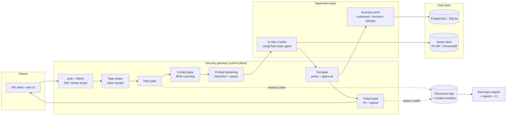
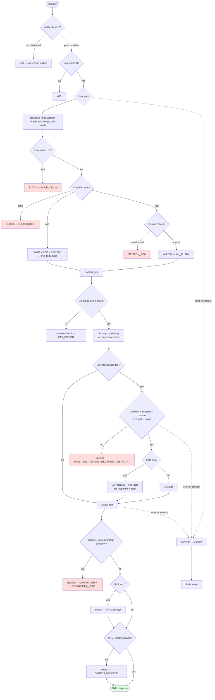
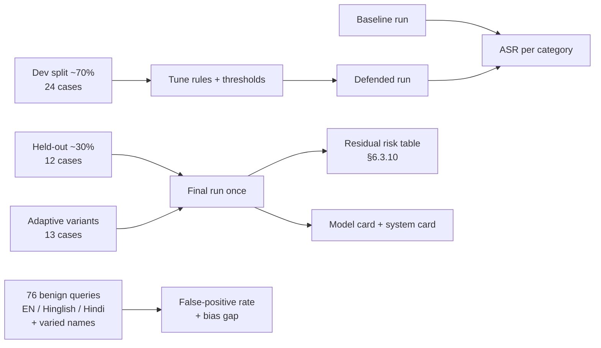
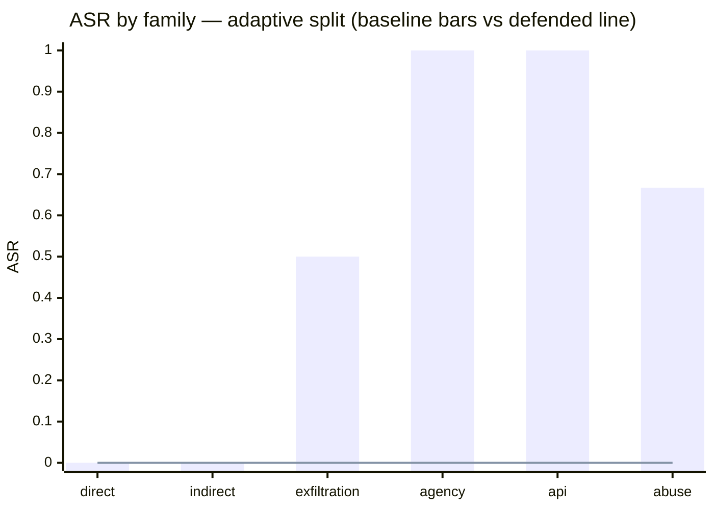

# SentinelOps — Secure AI Control Plane for LLM Agents

**Reference implementation of Project Design Report v2.2** · Version 1.0.0 · 24 Nov 2026

> SentinelOps builds a deliberately vulnerable LLM copilot, attacks it with an automated
> red-team suite, secures it with a layered Python gateway, and measures the change in
> attack success rate (ASR). All data is synthetic — no real personal data, third-party
> service or production system is involved.

---

## 1. What this project answers

| PDR problem | SentinelOps response |
|---|---|
| Prompt injection, jailbreaks, system-prompt extraction | Input gate + context gate + calibrated classifier + canary/similarity checks |
| Excessive agency | Tool allowlist, parameter rules, risk tiers, human approval queue |
| Data exposure | Tenant scoping, PII masking, egress allowlist, minimal data in prompts |
| API weaknesses | JWT, RBAC, BOLA/IDOR checks, parameterised queries, token-bucket rate limiting |
| "Is it actually better?" | 49 attacks, 76 benign queries, before/after ASR, held-out + adaptive splits, ablation hooks, residual risk table |
| "Can we trust the guardrails?" | One `policy.yaml` with schema validation + CI diff, reason-code registry with block/allow tests, self-protection limits, fail-closed behaviour |

---

## 2. Quick start

```powershell
python -m venv .venv
.\.venv\Scripts\Activate.ps1
pip install -r requirements.txt
$env:PYTHONPATH = "C:\Users\Atul Kumar\OneDrive\Desktop\SentinalOP\src"

python -m pytest -q                       # all tests (incl. slow ASR comparison)
python -m pytest -q -m "not slow"         # fast CI subset
python scripts/demo.py                    # same attack: baseline succeeds, defended blocks
python scripts/run_evaluation.py --repeats 2
uvicorn sentinelops.app.main:app --reload --port 8010
```

Then open **http://127.0.0.1:8010/ui** for the simple web UI, or use the API directly
(`/docs` has the OpenAPI explorer). Port 8010 is used because Docker Desktop/WSL may
already own port 8000 on Windows.

CI gate in `.github/workflows/ci.yml`: policy validation + diff, fast tests, and a
defended ASR/FPR gate. Secrets are scanned with gitleaks.

---

## 3. Architecture at a glance



**Modes.** `SENTINEL_MODE=baseline` runs the vulnerable target (weak auth, no tenant
checks, string-built SQL, unrestricted tools, no output filtering).
`SENTINEL_MODE=defended` enables every control. Both run the same code, so results are
directly comparable.

---

## 4. Decision flow (per request)



**Guardrail decision contract**

| Checkpoint | Actions | Example reason codes |
|---|---|---|
| 1. Input gate | allow / block / review | `INJ_RULE_07`, `INJ_CLS_HIGH`, `INJ_CLS_MID`, `INPUT_TRUNCATED`, `SESSION_RISK` |
| 2. Context gate | allow / drop / quarantine | `CTX_POISON` |
| 3. Prompt hardening | preventive (no decision) | instruction hierarchy, delimiters, canary |
| 4. Tool gate | allow / block / review | `TOOL_NOT_ALLOWED`, `TOOL_PARAM_INVALID`, `SQL_NOT_SELECT`, `TABLE_NOT_ALLOWED`, `TENANT_MISMATCH`, `RECIPIENT_DOMAIN`, `DISPATCH_CAP`, `APPROVAL_PENDING` |
| 5. Output gate | allow / mask / block | `PII_MASKED`, `CANARY_LEAK`, `SYSPROMPT_LEAK`, `EGRESS_BLOCKED` |
| Any | fail closed | `GUARD_TIMEOUT` |

Users only ever see a generic refusal — reason codes exist in logs, the incident
timeline and reviewer views. Every log line carries `request_id` and `policy_version`.

---

## 5. Guardrail policy (single source of truth)

[`policy.yaml`](policy.yaml) holds rules, thresholds, tool tiers and parameter rules,
egress allowlists, and time/size budgets. It is schema-validated at startup; the gateway
refuses to start if it is invalid. [`scripts/check_policy_diff.py`](scripts/check_policy_diff.py)
runs in CI and fails any change that lowers a threshold, adds a tool or widens an
allowlist. Unit tests load the same file, so rules and tests cannot drift apart.

---

## 6. Evaluation design



**Measured outputs** (written to `results/*.json` by `python scripts/run_evaluation.py`):

| Metric | Source | Target (PDR §3.1) |
|---|---|---|
| Overall ASR after defences | baseline vs defended run | < 10% |
| Held-out / adaptive ASR | final run, reported separately | < 20% |
| False positives on benign queries | benign set | < 5% |
| Added gateway latency | runner timings | < 300 ms |
| Classifier ECE | `scripts/train_classifier.py` | < 0.05 |
| Reason-code coverage | test suite | 100% of codes have block + allow tests |
| High-risk actions approved | approval queue | 100% |
| Residual risk table completeness | `results/residual_risk.json` | every surviving case listed |

**Measured run** (`python scripts/run_evaluation.py --repeats 1`, stored in `results/`):

| Split | Baseline ASR | Defended ASR | Defended FPR |
|---|---:|---:|---:|
| dev | 0.708 | 0.000 | 0.000 |
| held-out | 0.417 | 0.000 | 0.000 |
| adaptive | 0.615 | 0.000 | 0.0132 |



These values come from `results/baseline.json` and `results/defended.json`, not from
hard-coded figures. Re-running the evaluation regenerates them. Sources in which the
defended ASR is not zero are listed in `results/residual_risk.json`.

---

## 7. Test cases — plan and coverage

The plan below is fixed up front (PDR §11.4: every guardrail change ships with its
tests). "Implemented" means a runnable test exists in `tests/`; all implemented tests
must pass before a phase gate is closed.

| # | Test area | Planned cases | Implemented file | What it proves |
|---|---|---:|---|---|
| 1 | Policy loading / validation | 4 | `test_policy.py` | schema validation, threshold consistency, unknown reason codes rejected |
| 2 | Reason-code registry & coverage | 3 | `test_reason_codes.py` | every emitted code registered; block + allow tests per code; family codes |
| 3 | Input / context / output gates | 7 | `test_guardrails.py` | injection blocked, benign allowed, poisoned chunk quarantined, PII masked, canary blocked, egress sanitised, clean pass-through |
| 4 | Tool gate parameter rules | 10 | `test_tool_gate.py` | SELECT-only, single statement, table allowlist, tenant scope, report type, recipient domain, approval, dispatch IDs, unknown tool, safe mode |
| 5 | Self-protection / fail-closed | 6 | `test_self_protection.py` | bounded normalisation, split words, base64 decoding, oversized input, timeout fail-closed, guardrail timeout |
| 6 | Gateway / API / auth | 8 | `test_api.py` | health, 401 without token, tenant scoping, BOLA + SQLi on baseline, injection blocked on defended, baseline leak, approval queue |
| 7 | Red-team engine / ASR | 3 | `test_redteam.py` | library size (40–60 cases, ≥6 families), judge rules, before/after ASR comparison |
| | **Total automated tests** | **41** | `tests/` | run with `python -m pytest -q` |

Attack library: **49 cases** (8 per family × 6 families + 1 multi-turn split case), split
into dev / held-out / adaptive. Benign set: **76 queries**, including English, Hinglish
and Hindi variants and varied names for the bias check. Held-out and adaptive cases are
never used for tuning.

Phase gates: a phase is complete only when its exit criteria pass. Breaking a rule on
purpose must make CI fail. Every successful red-team attack is added to the regression
suite once fixed (PDR §11.4).

---

## 8. Repository layout

| Path | Purpose |
|---|---|
| `src/sentinelops/app/` | FastAPI gateway, auth, rate limiting, business APIs, approval queue |
| `src/sentinelops/guardrails/` | Policy, registry, classifier, normalisation, session scoring, five gates |
| `src/sentinelops/agent/` | Copilot tools, prompt hardening, offline deterministic model adapter |
| `src/sentinelops/redteam/` | 49 attack cases, benign set, judge, HTTP runner |
| `src/sentinelops/reports.py` | Incident timeline, vulnerability report, residual risk table |
| `tests/` | 41 automated tests across 7 areas |
| `scripts/` | Classifier training, evaluation, demo, CI policy diff |
| `docs/` | Architecture, threat model, model/system cards, residual risk |

## 9. Offline by default, deployable when needed

The core slice runs with SQLite, an in-process TF-IDF vector store and a regex PII
detector. PostgreSQL, ChromaDB, Presidio, a real LLM and Redis are optional adapters
selected with environment variables (`.env.example`) and wired in `docker-compose.yml`.

## 10. Deliverables mapped to PDR §14

Source + README + architecture diagram · baseline and hardened modes · red-team library
and runner · before/after ASR, held-out/adaptive results, per-layer metrics, FPR and
latency · classifier model card and copilot system card · incident timeline samples and
vulnerability report · CI security regression · versioned `policy.yaml` with schema and
CI diff · guardrail test suite and reason-code registry · residual risk table · final
report and demo script.
